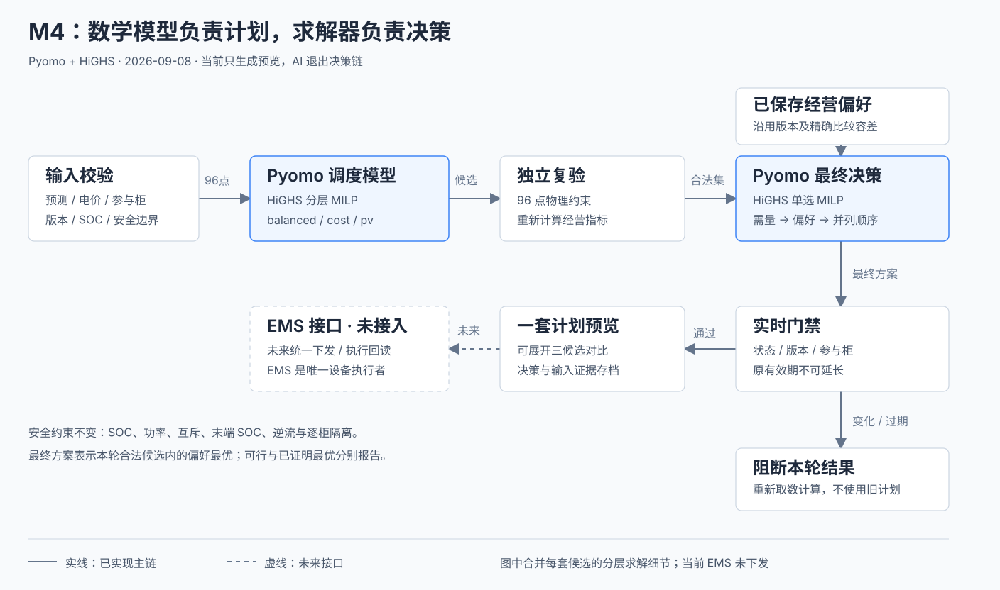

# M4 优化调度控制台概要设计

更新：2026-10-22（AI 调度效果对比已部署）。当前架构为 **Pyomo 建模 + HiGHS 求解与最终决策**。早期设计及静态原型保留为历史参考，生产策略及写表边界以[自动计划生成](自动计划生成.md)、[经济调度调整](求解器经济调度调整.md)与项目交接为准。

## AI 调度效果对比（2026-10-22，已部署）

唯一正式 HTML 新增费用概览、传统规则与 AI 规则对照、24 小时储能功率对比、重点差异时段及全天差异明细。展示直接复用已校验的当日日计划；费用沿用两方案吞吐费用和适用的日末电量调整口径。传统规则曲线使用与费用同源的 EMS 模拟结果，原设定窗口单独展示，不能用固定命令功率替代模拟功率计算费用。

按用户口径，求解器成功产出有效结果显示“AI优化成功”，采用状态另列。未采用的候选只有在版本及费用与后台比较结果一致时才展示为 AI 对比；否则明确展示当前 EMS 原方案或保守方案。无有效计划时展示原因，缺失数值不补零。支持图表点击、时段滑块、重点时段、明暗主题，保留原有收益、日计划与实测日志。

2026-10-22 22:49 仅以 Node-RED 当前 revision、`nodes` 部署方式更新 `m4-page-template`，其余 105 个节点不变；未更换镜像、重启容器、调整 Compose 或触发重算／写表。M4 healthy，自动生成及电站2写表开关均为1；现有三份必要 Compose 覆盖及其后续覆盖保持。发布前39项Node检查、6种对比状态、WebKit明暗×1440/834/390/320八组布局、收益／日志回归及真实数据预览通过。公网两站页面200且SHA与验收HTML一致；桌面／手机明暗截图已查阅，无页面脚本错误或非GET请求。电站2当轮显示预计净节省232.61元、降本9.65%；电站1当时无可用日计划，显示既有阻断原因。以上不代表实测节省或设备执行验收，未做登录后平台iframe验收。

证据：`outputs/m4/releases/2026-10-22-ai-comparison/`。初次容器清单哈希检查发现Docker挂载列表顺序变化，随后逐一重现前后排列哈希，确认容器身份、环境和挂载内容保持，见`verification.json`。生产备份：`/userdata/holo/pyfiles/vifa-ipc-158-prep-20261009/backups/m4-ai-comparison-20261022-224946/`；回退时读取该备份的`flows-predeploy.json`，以届时最新revision仅恢复`m4-page-template.template`，不整份覆盖其他节点或回滚业务数据。

## 职责

M4 汇总负荷/光伏/电价与储能能力，建立未来 24 小时、96 个15分钟时段的 MILP，计算合法候选并按已保存经营偏好求解最终方案。页面展示计划、比较依据、风险和复核证据。

M4 输出日计划及滚动建议，现有授权范围内的调度链路负责写入 EMS 计划表并回读。设备仍由 EMS 执行；计划生成、写表确认与物理设备执行分别验收。

图中合并了逐候选分层求解细节；此图为早期设计，虚线记录当时的接口边界，不作为当前接入状态证明。

## 建模与决策（早期设计）

1. 校验完整预测、电价、来源版本、时间对齐及参与柜能力；异常柜隔离，全站输入缺失或全部柜不可用阻断。
2. Pyomo 具名变量和约束表达功率平衡、SOC、充放及进出电互斥、末端 SOC、逆流与 PV 策略。
3. HiGHS 按分层目标生成 balanced/cost/pv。先处理需量峰值和累计超限，再处理各经营目标，最后处理吞吐量与可选谷段早充。
4. 独立复验96点计划并重算指标。最终单选 MILP 按需量两层、显式偏好和并列顺序求解；原确定性比较程序只用于独立审计。
5. 选择前后复核实时输入、参与柜、配置/偏好版本和原有效期；变化或过期则阻断，刷新不能延长旧计划有效期。
6. 返回一套最终建议及可展开的三候选比较，保存独立审计证据。

三候选保留是为了保持既有跨方案需量比较，不默认将 balanced 设为唯一计算目标。`optimal` 和 `feasible` 分别展示；数学选择最优仅针对本轮合法候选和显式偏好，不等于全局经营最优。

## 页面与接口

### 两 Tab 静态展示版（2026-09-10，历史原型）

展示范围以用户确认的 `m4-decision-1440-light.png` 为准，不追加账单统计、候选方案、设备状态等入口。此前额外区块整合已撤回；后续真实数据接入同样遵守此展示范围。

此静态原型及其模拟人工编辑／发送的专用测试已于2026-09-19退役，不作为正式功能验收入口。唯一正式页面为`m4/web/M4优化调度控制台-线上版.html`，保留正式页面、网关及后端测试；原型实现可从Git历史追溯。

- **电价策略决策**：策略结论 → 基准与计划费用、净节省、削峰、光伏消纳与储能电量 → 同时间轴的电价、购电、光伏、储能功率和 SOC → 可展开约束。时段滑块与图表点击联动，支持切换电站和计划日期。
- **调度记录**：示例记录及当前会话生成的计划；按电站、日期、状态和编号筛选，查看生成时的依据及 96 时段明细；提供缺失预测导致阻断的示例。不提供本地导出。
- 以同负荷、同光伏、不使用储能作为基准；净节省扣除购电和吞吐费用，不虚构月度需量电费收益。示例规则保留 SOC 边界、充放效率、功率平衡与日终电量约束；为展示规则，不代表真实优化器结果或最优解。
- “充”暂指储能充电，未建模独立充电桩。全部记录为模拟建议、未下发，不把计划当作真实执行回读；新增记录仅保存于页面会话，刷新后恢复示例数据。
- 复用 M3 明暗表面与 `dashboard-theme` 偏好。无外部依赖、网络接口、下载导出或真实设备操作。

### 截图布局的真实接口版（2026-09-10）

入口为 `m4/web/M4优化调度控制台-线上版.html`，与静态版采用相同两 Tab 布局；不含示例计算或模拟记录，不增加截图之外的业务区块。

- 首页读取 `GET settings / control-sources / daily-inputs / daily-plan`。按站点、当天日期、配置及控制版本、完整 96 点与推荐方案契约核验，缺失/失效时隐藏数值及曲线，在原结论区说明原因。可采用已校验的当天 EMS 基线，不能使用跨日旧计划。日期接口当前只支持当天；历史日期在记录页筛选。
- 切站和刷新先恢复按电站、日期隔离的最近 5 分钟快照，并在原状态标记中提示“缓存快照 · 正在更新”；后台重新校验。上次所选电站和快照保存在当前浏览器标签页，凭据仅以摘要区分缓存，不存原始 Token。快照不赋予生成权限，核对期间按钮禁用；失败、跨日或到期清除。首次未读取的电站仍需等待接口，同站进行中请求合并。
- 按钮只在当天输入可比较时可用，用户点击发起 `POST daily-plan`，随后 GET 回读；不自动重复提交。仍由后台执行 MAPE、SOC、需量及期末电量等校验，前端不代替优化器。
- 真实费用基准为 EMS 原计划，不沿用静态示例的无储能口径。净电费为购电费减售电收益，预计净节省再计入两方案吞吐费用差；没有相关指标就不显示，不用 0 补缺失。削峰、光伏和储能电量取自匹配本轮输入及计划。削峰指标仅计算峰/尖峰时段：基准最大购电功率 − 计划最大购电功率；下降比例以该范围基准最大值为分母。它不是全天峰值差，也不是单时段最大降幅。缺失分时电价或无峰段时不回退全天口径。
- 记录页查询 `GET decision-history / decision-results/{run_id}`，合并最新 `daily-plan`。支持电站、日期、状态、编号筛选与完整时段详情，无导出。当前后台未提供更早的 daily-plan 归档查询接口，列表不是全部全天任务档案；每站最多读取 2000 条，超限提示。
- `?token=` 只用于同源 `/m4-api/` 请求，禁止重定向并使用 no-referrer。页面不会把凭据写入记录或显示文本。

本地已有 M4 API 时，执行 `python3 m4/scripts/preview_console.py --port 8847 --upstream-port 8848`，访问 `http://127.0.0.1:8847/m4` 可预览最新 HTML，不必重启旧服务。预览仅监听本机，允许指定查询路径和同源手动计划计算，未提供设备控制代理。

验证：`m4/tests/m4_reference_live_e2e.js` 为当前截图版前端验收，覆盖正常数据、缺失与无效计划、站点响应隔离、筛选详情及明暗响应式布局。旧五 Tab 页面专用测试不再对应当前 UI。已完成本机真实 API 只读联调：13 条记录及 96 点详情可读；随后修复本机旧服务连接后，两站当前任务 MAPE 已可评估；电站1仍因零点 SOC 安全边界阻断，电站2全天输入可比较。不代表生产已部署。

## EMS 对接边界

未来需要 EMS 统一计划下发、接收结果与执行回读接口。M4 不依赖 EMS 内部模板调用或规则仲裁实现；单柜分配由 EMS 负责。当前所有结果固定 `preview_only / not_dispatched`，不会向真实设备发送指令。

## 说明入口

- [运行与兼容说明](求解器决策说明.md)
- [详细架构与约束](specs/2026-09-08-m4-solver-decision-design.md)
- [数学优化器](optimizer/README.md)
- [最终数学决策](selection/README.md)
- [经营偏好配置](选择偏好配置说明.md)
