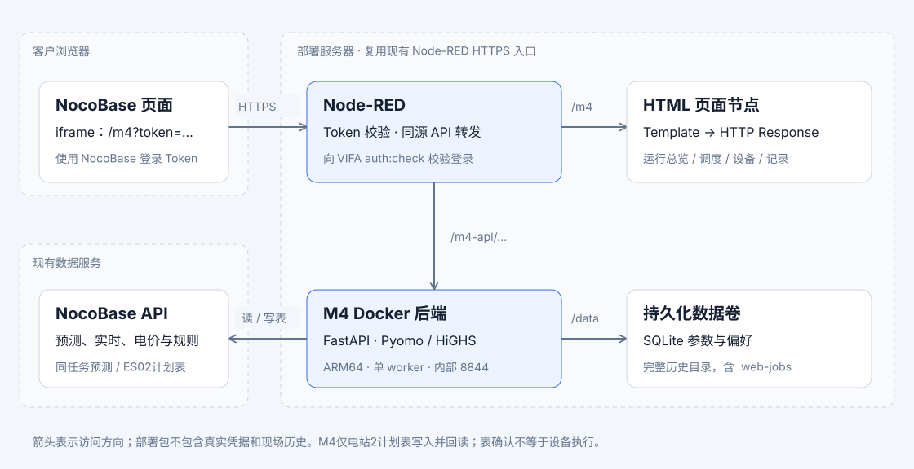

# M4 部署手册

更新：2026-10-12。区分**现有ARM64工控机更新**与**通用M4独立实例交付**，不再把旧AMD64/OPDash/EMS三域方案当作唯一生产架构。跨模块入口为仓库 `docs/服务器部署架构.md`；现场过程为 `docs/m4/deploy/工控机迁移准备-192.168.3.158.md`。

本文依据本地源码/配置和2026-10-09至10-10部署记录整理，未连接服务器，以下命令未执行。历史授权不延续；构建、推送、部署、启动自动任务和写表须本次明确授权。

## 1. 当前工控机链路



```text
VIFA父平台 iframe → HTTPS aivifa.hlszh.com/m4
  → Node-RED：VIFA auth:check、正式HTML、/m4-api白名单
    → 127.0.0.1:8844 → M4 API（单Uvicorn worker）
      ├─ /data：参数SQLite、完整solver-decisions历史
      ├─ Worker Unix Socket：同任务预测/评分结果读取
      ├─ VIFA：实时、电价、规则、独立PV预测读取
      └─ 仅ES02 t_model计划表写入 → 新GET整版回读
          → 既有EMS工作流；设备执行单独验收
```

页面/API同源，HTML不填后端IP；内部8844不开放公网。工控机Node-RED是宿主机服务，M4使用host网络，不使用旧 `http://m4-api:8844` bridge别名。ARM64及 `/dev/mqueue` tmpfs适配保留。

保留单容器、单Uvicorn worker：求解锁及候选缓存含进程内状态，当前不支持多worker/副本。参数和运行历史使用本机文件系统，不用NFS共享运行目录。

父域、认证域、页面域和数据源分开配置。接管记录中M3/M4父域及认证域为 `https://vifa.hlszh.com`；M1基础数据改EMS不能顺带修改M4认证或共用项目配置。通用Flow旧域名默认值不能覆盖现场。

## 2. 现场目录与Compose

现场根目录记录为 `/userdata/holo/pyfiles/vifa-ipc-158-prep-20261009`，M4位于其 `backend/`；名字含prep但已正式接管，不能作为准备残留删除。

```bash
cd /userdata/holo/pyfiles/vifa-ipc-158-prep-20261009/backend
M4_COMPOSE_FILES=(
  -f compose.yaml
  -f m4-production.override.yaml
  -f m4-ems-table.override.yaml
  -f m4-preparation.override.yaml
  -f m4-active.override.yaml
)
```

**前三份正式文件必须保留**；现有ARM64现场还需后两份按此顺序覆盖。preparation提供host/ARM64/mqueue兼容且曾关闭自动任务；active在最后恢复正式值。漏active可能关闭自动计划，漏兼容覆盖可能恢复不支持的网络/架构。

更新后读取实际运行环境核对 `M4_AUTO_PLAN_ENABLED=1`、`M4_EMS_STATION2_TABLE_WRITES=1`、`M4_BIND_HOST=127.0.0.1`。电站1写表保持关闭。沿用UID/GID10001及受控凭据权限，不用root业务进程绕过权限错误。

**实际配置优先于文档快照**：获授权后先用目标容器Compose标签核对文件列表、项目名、镜像和挂载，再生成更新命令；不直接覆盖 `.env` 或使用初次准备包恢复现场。

## 3. 不混用两套镜像发布路径

| 场景 | 生效镜像/配置 | 边界 |
|---|---|---|
| 现有ARM64工控机 | 共享运行镜像；preparation覆盖从 `RUNTIME_IMAGE` 取值 | 仅改 `M4_IMAGE` 未必生效；只重建目标服务，不连带Worker/PV |
| 通用M4独立实例 | `m4/deploy/build-and-push.sh`发布CCR `vifa-m4:0.1.0-<architecture>`；以 `M4_IMAGE` 配置 | 用本次release完整摘要；不能自动替换现有共享运行镜像 |

2026-10-10后续Worker专项发布只重建Worker，Dashboard/PV/M4未动；M1临时容器实时读共享镜像变量，M2已用 `M2_RUNTIME_IMAGE` 独立覆盖。**同仓库/同变量不等于全部运行容器同digest**。共享变量切换前须核实所有消费方及新镜像入口/依赖，不用文档中的缩写digest构造可执行引用。

## 4. 通用独立实例交付

一项目一实例，配置入口 `VIFA_PROJECT_CONFIG`，独立参数库、历史、卷、端口及网络别名。新项目配置及限制见发布包 `产品化配置与交付.md`（仓库 `docs/产品化配置与交付.md`）。

获授权后在本机构建/推送，服务器拉取运行：

```bash
# 仓库根目录；Docker登录使用安全凭据管理
bash m4/deploy/build-and-push.sh
# ARM64目标明确指定架构
PLATFORM=linux/arm64 bash m4/deploy/build-and-push.sh
```

脚本默认CCR仓库 `ccr.ccs.tencentyun.com/taidai-holobase-168/vifa-m4`，变量名仍为 `CRR_IMAGE`；默认linux/amd64，支持linux/arm64。按白名单构建当前工作区（含相关未提交/新增源码），只推固定架构标签，Git基线与实际内容摘要单独存证。固定标签会覆盖，不能当回退版本。

成功后 `outputs/m4/releases/` 保留配置、Function源码、手册、release.json、SOURCE_SHA256SUMS和SHA256SUMS；临时完整构建目录结束后清理。普通发布无ZIP、Flow或独立HTML副本，不附凭据、参数库和历史。

新实例首次安装须另行确认：目标架构/网络、Node-RED运行方式、镜像、独立实例名/卷/端口、外部项目配置、M3/PV来源、上游表权限及真实参数。已有现场配置沿用，凭据安全安装，不打印完整环境。自动任务启动及电站2写表需独立明确授权；使用正式三份Compose及有效开关，不把基础文件默认值当生产值。

通用TCP实例中，宿主Node-RED访问本机绑定端口；容器Node-RED需共享网络和独立 `M4_BACKEND_ALIAS`，其127.0.0.1不是宿主机。该通用规则不是现有工控机的bridge部署命令。

## 5. 更新、验证和回退

### 更新前

- 在部署准备阶段按AGENTS执行相关测试及必要布局检查，不在生产跑测试；历史通过不代表当前版本。
- 核对目标容器、Compose标签、任务状态、镜像、架构、挂载和开关；有运行任务时先评估停机，不擅自中断。
- 备份实际Compose、env、外部project.json及受影响Flow；一致性备份参数库与完整历史。保留可用旧完整镜像引用/ID，不依赖可变标签。
- 现场数据卷记录为 `vifa-ipc158-prep-data`。旧试装 `vifa-m4-data` 已被授权清理，不再是可用回退卷。

### 当前工控机更新范式

确认现场仍用第2节组合、镜像范围明确并获授权后，设置实际生效镜像变量，人工核对回显，再执行：

```bash
# 已在backend定义完整 M4_COMPOSE_FILES；不输出含凭据的全量config
docker compose "${M4_COMPOSE_FILES[@]}" config --images
docker compose "${M4_COMPOSE_FILES[@]}" pull -q m4-api
docker compose "${M4_COMPOSE_FILES[@]}" up -d --no-build --no-deps --force-recreate m4-api
docker compose "${M4_COMPOSE_FILES[@]}" exec -T m4-api python -c \
  'import os; assert os.environ.get("M4_AUTO_PLAN_ENABLED") == "1"; assert os.environ.get("M4_EMS_STATION2_TABLE_WRITES") == "1"'
docker compose "${M4_COMPOSE_FILES[@]}" ps
```

这是生产重建操作，可能恢复/触发自动计划和写表，**不是只读检查**，文档整理不执行。通用独立发布使用脚本输出的完整命令，同样不能省略电站2覆盖或套用旧固定标签。

### 更新后

- 读回实际运行镜像、架构、UID、挂载和开关，不仅看配置文件或healthy。
- preflight.py检查依赖/HiGHS/权限/最近任务标记；0通过、1失败、2表示有running标记不宜停机。healthcheck.py只读本地参数库，不证明上游可用。
- 经真实登录网关读回两站参数、日计划和数据就绪项，确认无502、历史未丢、输入错误如实展示；实际iframe另行验收。
- 只有另有业务写授权才生成/替换计划，用精确run_id、新GET整版回读和协调器无pending/hold异常确认写表；设备执行另需证据。

### 持久化与回退

保留 `/data/settings.sqlite3`、存在的SQLite辅助文件和整个 `/data/solver-decisions/`（含 .web-jobs、锁及隐藏状态），已有退役分配历史也保留。禁止 `docker compose down -v` 或把完整决策历史当缓存清理。

SQLite使用一致性备份；直接复制先按授权停止写入并确认无任务，不能只复制活跃主文件。迁入内容归UID/GID10001；入口不递归修复所有旧文件权限。

回退恢复事先备份的有效Compose/配置，使用兼容旧镜像，仅重建目标服务。数据不兼容时恢复到独立新卷并校验，保留当前卷；不能假定旧代码能读新格式。自动及写表开关保持授权值。

## 6. 页面、认证与网关

唯一正式HTML为仓库 `m4/web/M4优化调度控制台-线上版.html`。仅HTML变动只替换既有Template，不更新Flow JSON或运行副本同步；网关逻辑变化才处理Function/Flow。首次安装显式 `--include-flow`，不重复导入相同路径。

页面/API路径 `/m4`、`/m4-api/...` 同源；保留现场有效 M4_PUBLIC_ORIGIN、M4_FRAME_ORIGIN、M4_BACKEND_URL，不恢复OPDash/EMS默认值。Template使用纯文本HTML，不用Dashboard ui_template代替HTTP页面。生产Template记录在 `/root/.node-red/flows.json` 的m4-page-template，实际目标先读回核实；不得整包覆盖prepared-flows.json。

iframe用当前用户 `{{ ctx.token }}`，API用Bearer。网关固定向签发域auth:check校验；401/403、异常、超时、重定向不放行。校验后按白名单转发，清除浏览器凭据，不允许浏览器指定后端地址。当前登录有效校验不新增用户级电站分权。

发布前检查现场HTML漂移并备份Flow。daily-dispatch、bills等资源需对应网关白名单；退役allocations接口不恢复。仅换HTML不能修复遗漏API或关闭旧接口。

HTTPS/CSP允许真实父域，不通过移除现有认证解决iframe问题。日志隐藏首次URL token参数，后端/Worker/PV服务令牌不进入浏览器。父平台Token注入、登录iframe和真实交互不能用裸HTML200验收。

## 7. 业务与计划表边界

- 日计划使用北京时间自然日同任务15分钟预测；评分不再作为准入门槛，完整性、时效、安全、单站全天100元收益门槛和独立校验保留，不套用旧95点滚动规则。
- 自动链路为预测→求解→安全校验→写表→回读/恢复；已确认计划冻结，重算不自动覆盖，显式替换只处理未来。
- 凌晨保底与全天优化分开；优化failed/整体waiting不能直接推断已确认保底写表失败。过去时段不补发。
- 写表带m4_run_id/m4_plan_date；往日标已过期保留，当天按原冲突规则处理，删除仅限受控M4记录，hold/并发/幂等保护不绕过。
- 只输出站级计划，柜分配由EMS负责；写表报文规则不等于求解上限或实时设备能力。
- t_model写入可能触发既有EMS工作流，不是无副作用存储。表回读、环境开关注释、HTTP成功均不证明设备受抑制、收到或执行。

业务细节见仓库 docs/m4/自动计划生成.md、EMS对接材料.md、调度参数配置说明.md和当前交接。历史盘点中的“仅预览/尚无写表”不是现行口径。

## 8. 常见问题与证据边界

| 现象 | 优先核对 |
|---|---|
| 页面/API401 | Token注入/过期，签发域与认证域是否一致 |
| API404/502 | 白名单/前缀、内部服务/地址、是否混用host与bridge |
| 保存403/iframe拒绝 | 页面Origin、父域CSP、sandbox和额外认证 |
| healthy但无计划 | 当前输入完整性、同任务负荷/PV、安全校验和任务错误 |
| 自动意外关闭 | 实际Compose顺序及active/运行环境，不仅查基础文件 |
| 参数/历史为空 | 卷名/挂载/项目配置漂移，是否误建新卷 |
| M1/M2一起故障 | 共享镜像与模块完整性、launcher有效配置，不只查M4 |
| 表确认但设备未知 | EMS回执与实测证据，不能按时间推断执行 |

验收记录、旧发布包和历史镜像仅证明当时版本/范围。本次仅维护文档/图，不运行测试、构建、部署、写表或设备操作。整理前手册可用 `git show 8394b69:docs/m4/deploy/部署手册.md` 追溯。
