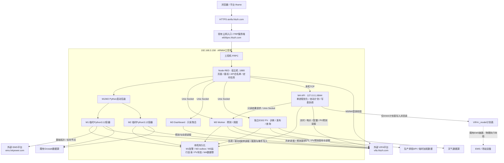

# VIFA 服务器部署架构

整理日期：2026-10-12。依据仓库配置与2026-10-09至10-10部署记录整理，**本次未连接服务器，本文不是10月12日实时健康报告**。生产部署、镜像替换、自动任务与设备操作仍须本次明确授权。

本文是M1–M4服务器拓扑的统一入口；模块业务规则和历史证据继续保留在各模块文档。配套[架构图](服务器部署架构.html)可离线打开。

## 1. 部署结论

- 业务计算集中在 **192.168.3.158 ARM64工控机**；记录中的系统为Ubuntu 20.04.6，业务Python为3.12.15。宿主机Python3.8只作为M1/M2 Docker启动包装，不运行其业务代码。
- **Node-RED是页面与API统一入口**，作为宿主机systemd服务运行。M1/M2按请求或定时启动临时容器，M3 Worker、Dashboard、独立PV和M4 API分别使用常驻容器。
- 页面域为 `https://aivifa.hlszh.com`，经现有公网入口和FRP到达Node-RED；不新增业务反向代理，不向公网开放M3/PV Socket或M4 8844端口。HTTPS终止组件的具体实现本次未核实。
- **VIFA与EMS平台仍是外部依赖，不是本次已迁入工控机的应用**。M3/M4父页面与认证使用VIFA；M1基础数据改用EMS，负荷/柜功率仍用VIFA，Growatt来源保持原配置。
- M4自动生成及**电站2计划表写入**已在部署记录中确认开启，电站1写表关闭。写表可能触发既有EMS工作流，不能当成纯存储；回读确认不等于设备实测执行。
- `opdash.lvkpower.com`、旧AMD64主机和旧 `vifa-m3` 安装目录不作为这套工控机运行链路的依赖。

## 2. 总体拓扑



箭头表示请求或数据处理方向；虚线是尚未完成设备闭环验收的下游。图中不表示新增数据库、网关或设备协议。

## 3. 服务职责与运行方式

| 组件 | 运行方式 / 内部接口 | 外部入口或触发 | 写入范围 |
|---|---|---|---|
| Node-RED | 宿主机systemd；内部1880 | 页面、API及定时节点 | Flow配置属部署写操作；业务转发权限由目标接口决定 |
| M1 | NR exec → `node_red/m1-launcher.py` → `docker run --rm` | `/monitor`、`/dashboard_energy_api` | 查询可能保存本地告警SQLite；不写上游控制表 |
| M2 | NR exec → `node_red/m2-launcher.py` →临时容器 | `/eff`、`/energy-efficiency-api`；两站分钟任务、02:10清理 | 能效分钟点、设备点、瓶颈事件及本地outbox；清理只涉及保留期外设备点 |
| M3 Worker | 常驻容器；`/run/vifa-m3/worker.sock` | `/energy-forecast-api/custom-*`；每日调度 | 负荷/SOC任务、预测点、评估；不是设备控制服务 |
| M3 Dashboard | 常驻容器；`/run/vifa-m3/dashboard.sock` | `/ett`、`/energy-forecast-api` | 只读聚合预测和实绩 |
| 独立PV | 常驻容器；`/run/vifa-pv/pv.sock` | 现有PV网关；北京时间06:00、22:00 | ES02天气/训练状态、PV预测批次与点；ES01尚未接入 |
| M4 API | 常驻容器；`127.0.0.1:8844` | `/m4`、`/m4-api/...`；每15分钟自动检查 | 本地参数/完整决策历史、ES02计划表；电站1写表关闭 |
| FRPC / 1Panel / SSH | 现有基础设施 | 管理端口见下表 | 不属于M1–M4业务计算 |
| 本地PostgreSQL | 既有运行服务及 `/userdata/holo/nb` 数据 | 依赖关系未在本次重新核实 | 保留；不能据其存在推断VIFA/EMS NocoBase已迁入 |

M3常规预测、自定义/每日预测和滚动SOC不是同一消费链路。M4日计划读取同一当前15分钟/1天任务的预测，不拼接跨任务输入；滚动SOC接口尚未接入正式页面或M4。

## 4. 网络与域名

| 用途 | 公网入口 | 工控机内部目标 | 说明 |
|---|---|---|---|
| 正式业务页面/API | `https://aivifa.hlszh.com` | 经NR转发链到1880 | 普通用户入口；避免使用裸HTTP管理端口承载登录Token |
| FRP连接 | `e606pro.hlszh.com:7000` | FRPC主动连接 | 记录中的FRP服务端，不是业务API |
| Node-RED管理/原始HTTP | `e606pro.hlszh.com:2216` | `127.0.0.1:1880` | 管理接口需认证；不能因为页面可达就放开 `/flows` |
| SSH | `e606pro.hlszh.com:2217` | `127.0.0.1:22` | 运维入口；严格核对主机密钥 |
| 1Panel | `e606pro.hlszh.com:2218` | `127.0.0.1:22222` | 管理入口，不是用户页面 |
| 本地NB预留转发 | `e606pro.hlszh.com:2215` | `127.0.0.1:80` | 历史记录为NB应用未启动；不作为可用平台入口 |
| M4内部API | 不开放公网 | `127.0.0.1:8844` | Node-RED同机访问，不用旧Docker网络别名 |
| M3 / PV | 不开放公网TCP | Unix Socket | Node-RED与后端须能访问同一宿主机Socket目录 |

工控机使用 **host网络及 `/dev/mqueue` tmpfs** 兼容已有内核约束；不是旧AMD64的共享Docker bridge网络方案。业务页面API同源，不需要在HTML填入后端地址。

## 5. 目录、配置和数据边界

现场目录名称虽带 `prep`，已经用于正式接管；**不要因名称含prep而清理或重建为空目录**。

```text
/userdata/holo/pyfiles/vifa-ipc-158-prep-20261009/
├── .env                         # 私有镜像/运行配置，不提交
├── compose-services.yaml        # m3-worker / m3-dashboard / pv
├── compose-active.override.yaml # 正式启动方式及重启策略
├── compose-pv-active.override.yaml
├── backend/
│   ├── compose.yaml
│   ├── m4-production.override.yaml
│   ├── m4-ems-table.override.yaml
│   ├── m4-preparation.override.yaml # ARM64/host/mqueue，含历史关闭值
│   ├── m4-active.override.yaml      # 最终运行覆盖，恢复自动开关
│   └── .env
├── node_red/                     # M1/M2 launcher及交付用网关素材
├── config/project.json          # 实例项目配置；只读挂载，非浏览器配置
├── secrets/                     # Worker/Dashboard env、数据源/管理凭据
├── overrides/                   # 记录中的PV只读源码修复挂载
├── runtime/m1/                  # 告警SQLite
├── runtime/m2/                  # 事件outbox SQLite
├── run/m3/                      # worker.sock / dashboard.sock / 管理Token副本 / 缓存
├── run/pv/                      # pv.sock / 任务 / 训练源 / 成功指针
└── backups/                     # Flow、配置与一致性数据备份
```

此树是已记录的布局，不是本次读取的远端目录清单。现场Node-RED运行Flow在 `/root/.node-red/flows.json`，不是准备包 `prepared-flows.json`；后者不能整包覆盖已启用的现场Flow。

| 数据 | 已记录的持久化位置 | 备份/更新要求 |
|---|---|---|
| M1告警历史 | 部署目录 `runtime/m1/`；默认 `alert_history.sqlite3` | 查询容器统一挂载；显式数据库配置优先，不能重建成空历史 |
| M2事件outbox | 部署目录 `runtime/m2/`；文件名以有效配置为准 | 保留待补写事件及SQLite一致性；事件计算数量不代表写入成功 |
| M3运行状态/缓存 | `run/m3` → `/run/vifa-m3`；缓存已记录为 `cache/raw_history.db` | 保留运行状态与令牌文件；缓存不能代替上游错误校验 |
| PV任务/训练 | `run/pv` → `/run/vifa-pv` | 保留实际训练源、成功指针、任务状态及配置里的路径 |
| M4参数与历史 | 命名卷 `vifa-ipc158-prep-data` → `/data` | 保留 `settings.sqlite3`、完整 `solver-decisions/`、隐藏任务/锁状态；数据库做一致性备份 |
| 外部业务数据 | VIFA/EMS既有平台集合 | 不是容器本地卷；工控机文件备份不能替代平台备份 |

旧试装 `vifa-m4-data` 已在2026-10-09授权清理中删除，不能再作为现存回退卷。旧生产机完整历史迁移尚未验收；工控机试装参数复制不等于全部业务状态迁移。

## 6. 认证、凭据与权限

- M3/M4页面父域及 `/api/auth:check` 认证域在接管记录中为 `https://vifa.hlszh.com`。M1切EMS数据源不能顺带把M3/M4认证或共用项目配置改成EMS。
- iframe使用当前用户 `{{ ctx.token }}`，API使用Bearer请求头；服务端数据源Key、Worker管理员Token、PV服务Token不能放入iframe、HTML、Flow明文或日志。
- M3 Node-RED读取 `run/m3/.worker-admin.token`；M4通过只读挂载使用Worker管理令牌和Socket。拥有管理Token不意味着允许触发预测，M4消费已有结果不应主动重算M3。
- 2026-10-10写入恢复记录中，Worker与PV曾获准复用已有root角色Key。这是**已记录的权限遗留项**，不是已完成最小权限整改。后续应按 `m3/contracts/nocobase_collections.json` 核验专用角色、逐表动作及字段，再安全轮换；本次不修改凭据或权限。
- M1/M2业务容器及M3/M4运行账户记录为UID/GID10001；只读根文件系统、必要持久化挂载和受控凭据权限应保留。Node-RED宿主机root运行及Docker调用属于另一个权限边界，不能称整机全栈非root。
- M3/M4现有登录校验不等于新增用户级电站隔离；多项目按配置、数据、运行目录和实例分开，不用同实例切换项目。

## 7. Compose与镜像发布边界

### M3 / Dashboard / PV

已记录的生产组合为：

```text
compose-services.yaml
→ compose-active.override.yaml
→ compose-pv-active.override.yaml
profile: cutover
```

### M4工控机

已记录的生产组合**按顺序**为：

```text
backend/compose.yaml
→ backend/m4-production.override.yaml
→ backend/m4-ems-table.override.yaml
→ backend/m4-preparation.override.yaml
→ backend/m4-active.override.yaml
```

必须保留前三份正式文件；ARM64现场还须保留其后两份。不能只加preparation而漏active，否则历史 `M4_AUTO_PLAN_ENABLED=0` 会覆盖正式开启值。更新后须读取实际运行环境，核对 `M4_AUTO_PLAN_ENABLED=1`、`M4_EMS_STATION2_TABLE_WRITES=1`；不能只看基础Compose默认值。

**镜像配置不等于全部运行容器版本。** `RUNTIME_IMAGE` 被多个消费方使用，但2026-10-10后续发布只重建Worker，Dashboard/PV/M4未同步重建；M2还已设置独立 `M2_RUNTIME_IMAGE`。M1/M2临时容器会在调用时读取有效镜像配置。不可把“同仓库/同变量”写成“四模块目前同digest”。

| 范围 | 最近已记录的版本线索 | 不可推断的内容 |
|---|---|---|
| M3 Worker | `m3-saturday-hours-20261010-arm64`；含SOC供体分层回退v3；当次 `/ready` 200 | 文档只有缩写digest，不可将其用作可执行镜像引用；不能证明今天仍是同一版本 |
| M2临时任务 | `m2-no-time-misaligned-20261010-arm64`；`M2_RUNTIME_IMAGE`独立配置 | 不随Worker重建自动升级；不能恢复旧全局时间跨度屏蔽规则 |
| M1临时任务 | 通过 `RUNTIME_IMAGE`选镜像；基础数据源由现场launcher覆盖到EMS | 镜像内项目默认值未必等于launcher最终有效配置 |
| Dashboard / PV / M4 | 最近Worker专项发布明确未重建这些容器 | 不能把最新Worker标签套用于全部服务；PV仍需核实源码覆盖挂载 |

更新前读回每个目标容器的Compose标签、镜像引用、挂载和有效开关；不执行会暴露全部环境凭据的输出。只重建目标服务，保留原数据，使用实际Compose组合及profile，必要时加 `--no-deps` 防止联动重建。

构建在获授权的本机进行，ARM64镜像发布至CCR并按完整摘要固定；服务器拉取运行。`m3/deploy/Dockerfile`现在包含M1/M2、M3 Worker/PV、M4四包、shared及config，切换共享变量前仍须检查所有消费方入口和依赖。M3旧Compose固定AMD64，不可直接替代这套现场文件。M4通用产品发布脚本见[部署手册](m4/deploy/部署手册.md)，其独立镜像发布路径不能自动替换工控机的共享运行镜像。

正式HTML仍只有README/AGENTS列出的四份源文件；仅页面改动不生成或同步Flow副本。网关逻辑改变才单独处理Function/Flow，并备份、检查线上漂移。

## 8. 核验层级与待验收项

| 层级 | 应核对的证据 | 不能替代 |
|---|---|---|
| 进程/镜像 | 实际容器、Compose组合、架构、镜像、挂载 | 配置文件存在不能证明启动成功 |
| 就绪 | Worker UDS `/ready`、恢复日志、调度器状态；M4本地健康 | Docker healthy不能证明预测/上游可用；M3各部署探针可能不同 |
| 数据 | 对应电站、任务、日期、点数、时效、分钟写入/outbox | 200或历史成功不能证明当前全天输入完整 |
| 页面 | 从实际父平台登录、iframe、鉴权、同源API和真实交互 | 裸HTML200或离线截图不能证明iframe通过 |
| 写表 | 精确run_id、未来生效时段、整版新GET回读、无pending/hold异常 | 写表确认不能证明EMS设备收到或执行 |
| 设备/收益 | 设备回执、同版计划关联、真实功率/电量和结算口径 | 时间推算“已执行”、预计收益不是物理闭环证据 |

尚未闭环：旧生产机完整历史迁移、平台登录后iframe验收、M2清理首轮及事件outbox生产恢复证据、ES01光伏接入、设备执行与真实收益、遗留测试失败及最小权限整改。2026-10-10电站1计划曾因日末SOC浮点边界阻断、电站2当天优化曾因缺预测阻断；这只是当日记录，不作为今天状态。

## 9. 文档分工与过时材料

- 本文：跨模块部署拓扑、运行方式、网络、持久化和边界。
- [M3部署说明](m3/部署说明.md)：预测服务行为、就绪语义、缓存及专项发布；[生产排班接入](m3/生产排班接入.md)：最近Worker发布记录。
- [M4部署手册](m4/deploy/部署手册.md)：M4发布、配置、更新和回退操作；[工控机迁移记录](m4/deploy/工控机迁移准备-192.168.3.158.md)：现场过程与证据，不再作为架构总览。
- [M2部署与任务说明](m2/M2线上部署流程图.md)：接口、分钟写入、清理和outbox契约；[M1告警说明](m1/时间与历史告警说明.md)：本地历史持久化。
- [当前交接](../CODEX_HANDOFF.md)：当前目标与未结事项，不持续累积版本流水。

已删除旧 `docs/m3/AMD64三域Docker部署手册.md`，其部署拓扑与路径已被本文替代；认证、验收表权限和数据保留约束已保留在本文/M3说明。需追溯原始步骤时用 `git show 8394b69:docs/m3/AMD64三域Docker部署手册.md`，不是恢复旧部署。

M4旧接口盘点、迁移记录、历史plans/specs、发布快照与完整决策历史保留作证据；不因“过时”删除工作流调查、授权记录或运行数据。旧AMD64/PV独立Compose和构建脚本是代码资产，本次不删除或改动。

**本次实际核对范围：本地源码/Compose、部署记录、文档引用及Git差异；未运行功能测试、浏览器或布局检查，未构建、推送、SSH、部署、触发任务、写表或控制设备。**
